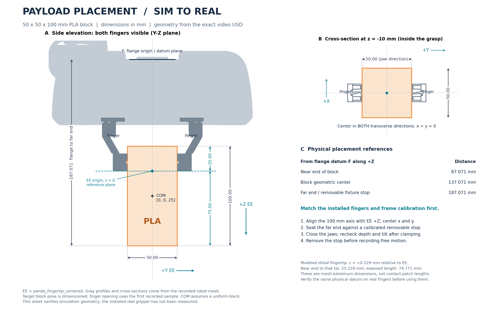

# External force sim-real gap measurement

Hold a 50 x 50 x 100 mm PLA block, rotate through a shared trajectory, and compare
simulated and real wrist force/torque. Follow sections 1–3 in order.

## 1. Run the simulation

### 1.1 Prepare the environment

Use your PC's Isaac Lab **3 / PhysX** GPU environment. The bundled robot and planner
are for **Panda**; an FR3 or different gripper needs a matching model.

From the repository root:

```bash
cd /path/to/frankatwin
python -m pip install -e '.[analysis]'

# Replace this with your Isaac Lab 3 launcher.
isaaclab=/path/to/IsaacLab/isaaclab.sh
```

The launcher must have the package's Python dependencies, including SciPy.
Run the commands below directly in your PC terminal and wait for each command
to finish before continuing. Analysis commands use the Python environment
installed above. Keep `isaaclab` set in the terminal used for simulation.

### 1.2 Set the experiment parameters

Edit [`config/force_gap.json`](../config/force_gap.json):

- `mass_kg`: actual measured block mass; `0.31` kg is only an estimate.
- `dimensions_m`: `[0.05, 0.05, 0.10]` for this block.
- `ee_com_m`: `[0, 0, 0.025]` for the placement shown in section 2.4.
- Leave the trajectory and controller defaults unchanged for the first run.

Use the same protocol for sim and real. Defaults produce nine poses over
50 seconds, with 4-second moves and 2-second holds. EE position stays fixed
while orientation changes; the joint plan returns to its initial posture.
Use new output directories for each experiment.

### 1.3 Collect simulated motion and forces — GPU

```bash
"$isaaclab" -p "$PWD/scripts/force_gap_sim.py" \
    --protocol "$PWD/config/force_gap.json" \
    --out "$PWD/data/force_gap/sim_loaded" --headless --video
```

The script initializes the block between the fingers, closes the hand through
physical contacts, warms up for 2 seconds, then executes the trajectory using
joint torque control. It records motion and wrist reaction forces at 1 kHz,
plus a scene video at 20 fps. The 50 seconds is trajectory time, not wall time.

**Result:** `data/force_gap/sim_loaded/` contains `samples.npz`, `metadata.json`,
`joint_plan.npz`, `summary.json` and `scene.mp4`.

### 1.4 Make the dashboard video

First, render the recorded states with the wider camera used in the example
video — **GPU**:

```bash
"$isaaclab" -p "$PWD/scripts/force_gap_render.py" \
    "$PWD/data/force_gap/sim_loaded" \
    --out "$PWD/data/force_gap/sim_render" --headless \
    --kit_args="--/persistent/rtx/modes/rt/enabled=true"
```

After rendering finishes, compose the dashboard — **analysis workstation**:

```bash
python scripts/force_gap_report.py analyze data/force_gap/sim_loaded --video \
    --scene data/force_gap/sim_render/scene.mp4
```

**Results, inside `data/force_gap/sim_loaded/`:**

| File | What to inspect |
| --- | --- |
| `dashboard.mp4` | Robot scene with synchronized force/torque traces |
| `joint_tracking.png` | Measured joints, commanded joints and initial posture |
| `wrench_O_K.png`, `wrench_K_K.png` | Six wrench channels against reference loads |
| `static_poses.png`, `analysis.json` | Settled-pose statistics and residuals |

Check `metadata.json` → `completed`, `summary.json` → grasp/tracking errors,
and `analysis.json` → unsettled poses. Finishing the trajectory does not mean
every hold settled.

This dashboard is a **sim/theory preview**, with no real measurements.
Rendering does not rerun physics or change the recorded force data.

## 2. Run on the real robot

### 2.1 Update and start the NUC daemon

Use the same checkout on the NUC and workstation. This workflow requires
shared-memory **ABI v5**; update both Python endpoints and rebuild the native
controller. Actual hardware execution still needs commissioning; the validation
so far covers simulation and software, not a physical-arm run.

In [`config/robot.yaml`](../config/robot.yaml), set:

| Setting | Value to check |
| --- | --- |
| `network.nuc_host` | NUC address reachable from the workstation |
| `robot.ip` | Robot FCI address reachable from the NUC |
| `paths.build_dir` | Directory containing the rebuilt binaries |
| `gripper.enabled` | `true` |

The configured tool/load must describe the **empty gripper and mounted equipment,
excluding the test block**. The collector preserves this model. In the daemon,
`load.mass: 0` skips `setLoad`; it does not clear an existing Desk load.

On the **NUC**, with libfranka and the real-time environment already installed
([installation guide](../docs/installation.md)):

```bash
cd /path/to/frankatwin
python -m pip install -e .
cmake -S . -B build
cmake --build build -j
python -m frankatwin.daemon --config config/robot.yaml
```

Keep this terminal running. Use a separate terminal on the workstation below.

### 2.2 Check the plan without moving hardware

```bash
python scripts/force_gap_real.py --protocol config/force_gap.json \
    --out data/force_gap/real_dry_run --dry-run
```

**Result:** `dry_run.json`, `joint_plan.npz` and `preview_targets.npz`.
This command plans the sequence without connecting to the robot.

### 2.3 Collect the empty-gripper baseline

Start with no object in the hand:

```bash
python scripts/force_gap_real.py --config config/robot.yaml \
    --protocol config/force_gap.json --empty \
    --out data/force_gap/real_empty
```

Enter the requested terminal tokens in order:

| Token | What to do before confirming |
| --- | --- |
| `RESET` | Remove objects and clear the motion workspace; the arm resets to `q_init` |
| `MODEL` | Verify the displayed empty-tool/load configuration |
| `OPEN` | Clear the fingers; the hand opens to 80 mm |
| `EMPTY` | Leave the hand empty; it closes to the block's nominal width |
| `RUN` | Clear the workspace; the arm executes the sequence |

**Result:** `data/force_gap/real_empty/` contains the baseline measurement.

### 2.4 Place the block and collect the loaded run

Start this command with the hand empty; placement happens **after reset**:

```bash
python scripts/force_gap_real.py --config config/robot.yaml \
    --protocol config/force_gap.json \
    --baseline data/force_gap/real_empty \
    --out data/force_gap/real_loaded
```

Follow `RESET` → `MODEL` → `OPEN` as above. Then position the block:



- Align its 100 mm axis with EE +Z and center it in both transverse directions.
- With the illustrated model, the block extends **25.23 mm toward the palm**
  from the distal fingertip and **74.77 mm beyond it**.
- A removable fixture can locate the far end **187.071 mm along flange +Z from
  the flange origin**. Verify that the real fingers and frame calibration match
  this model before using these dimensions.
- Support the block at the placement mark, clear the finger pinch area, and
  confirm `GRASP`. The command uses 35 N by default.
- Once grasping succeeds, remove the fixture/support and your hands, then
  confirm `RUN`.

Width and `is_grasped` checks cannot verify insertion depth, tilt or small slips.
Check placement after clamping and again after the motion. The arm holds its
final target; support the block before manually opening the hand. The collector
does not automatically release it, including on failure.

**Result:** `data/force_gap/real_loaded/` contains `samples.npz`, `metadata.json`,
`joint_plan.npz`, full-rate ring logs and `session.json`. Actual applied joint
references are recorded at 1 kHz; the 100 Hz network stream is for progress checks.

### 2.5 Plot the real measurements

```bash
python scripts/force_gap_report.py analyze data/force_gap/real_empty
python scripts/force_gap_report.py analyze data/force_gap/real_loaded
```

**Result:** wrench plots, joint tracking and `analysis.json` in each run directory.
The real collector does not record camera video, so omit `--video` here.

## 3. Generate the sim-real comparison

### 3.1 Replay the real commands in sim — GPU

On your simulation PC, use the **complete** `real_loaded` directory from section
2. Copy it there if collection used another machine. Replay it rather than
comparing against the standalone sim preview:

```bash
"$isaaclab" -p "$PWD/scripts/force_gap_sim.py" \
    --real-run "$PWD/data/force_gap/real_loaded" \
    --out "$PWD/data/force_gap/sim_replay" --headless --video
```

The script loads the real protocol, applied `q/dq` targets, initial joints and
EE/K transforms. No separate `--protocol` is needed. The original real run must
be complete and use `joint_pd_v1`.

**Result:** `data/force_gap/sim_replay/`, with simulated measurements for the
recorded real commands. If desired, repeat section 1.4 using `sim_replay` and a
new render directory to make a dashboard for this replay.

### 3.2 Produce the comparison plots — analysis workstation

Make both complete run directories available on this machine, then run:

```bash
python scripts/force_gap_report.py compare \
    --sim data/force_gap/sim_replay --real data/force_gap/real_loaded \
    --out data/force_gap/comparison
```

**Results, inside `data/force_gap/comparison/`:**

| File | Contents |
| --- | --- |
| `gap_O_K.png`, `gap_K_K.png` | Sim and real curves overlaid, in base/K axes |
| `residual_O_K.png`, `residual_K_K.png` | Sim minus real for all six channels |
| `gap_O_K.csv`, `gap_K_K.csv` | Aligned sim, real and difference values |
| `comparison.json` | RMSE, bias, per-pose statistics and actual motion mismatch |

Comparison checks protocol, controller, joint-plan hash, EE/K frames and loaded
condition. It uses overlapping time only, with no automatic sign, bias, scale
or delay fitting. The empty baseline is retained for inspection, not
automatically subtracted. For an empty comparison, replay `real_empty` with
`--empty` into another directory and compare that pair.

## 4. Parameter reference

Experiment settings live in `config/force_gap.json`; network and hardware
settings live in `config/robot.yaml`.

| Protocol parameter | Meaning / default |
| --- | --- |
| `mass_kg`, `dimensions_m` | Measured payload mass and XYZ dimensions in meters |
| `ee_com_m` | EE-origin-to-COM vector in EE axes; `[0, 0, 0.025]` m |
| `q_init` | Seven reset joint angles in radians |
| `rotation_waypoints_deg` | Rotation vectors relative to the initial EE orientation, in degrees; not Euler angles |
| `move_seconds`, `hold_seconds` | Transition / hold duration; 4 / 2 s |
| `settle_seconds` | Exclude the first 0.7 s of each hold from static scoring |
| `control_hz` | Joint reference update rate; 50 Hz, must divide the sim physics frequency |
| `joint_kp`, `joint_kd` | Seven joint stiffness/damping gains, in Nm/rad and Nm s/rad |
| `max_joint_speed`, `max_joint_acceleration` | Planned joint limits; 0.6 rad/s and 1.5 rad/s² |
| `grasp_force_n`, `gripper_width_tolerance_m` | Real grasp command / width tolerance; 35 N / 0.004 m |
| `kp_pos`, `kp_ori` | Legacy Cartesian settings; not the gains driving this joint-mode trajectory |

Useful sim flags: `--empty` for an empty hand, `--dt` for the physics step
(default 0.001 s), and `--video-fps` for capture rate (default 20).
`--duration 3` is a debug truncation and marks the run incomplete; do not use it
for the final comparison. `--allow-incomplete` on `compare` is diagnostic only.

For placement, EE means `panda_fingertip_centered`, not the flange or wrist
sensor. The default block spans EE z = -25 to +75 mm. Its geometric center is
its COM only if its density is approximately uniform.

## 5. Measurement and control principles

Both domains use the same control structure:

```text
EE pose sequence -> bounded continuous Panda IK -> q_des, dq_des at 50 Hz
-> zero-order hold -> joint PD + Coriolis at 1 kHz -> limited torque

tau = joint_kp * (q_des - q) + joint_kd * (dq_des - dq) + coriolis
```

Planning stays near `q_init` and checks IK residuals, joint limits, speed,
acceleration and endpoint return. It does not plan around obstacles. Both
controllers limit torque to `[87,87,87,87,12,12,12]` Nm and changes to 1000 Nm/s.
libfranka supplies gravity/friction compensation; sim explicitly compensates
robot gravity. The block remains an additional, uncompensated load. During sim
measurement the arm is torque-driven and the fingers hold the block through
contacts. Only initialization and the separate visualization renderer write
joint states directly.

| Signal | Meaning |
| --- | --- |
| Real `O_F_ext_hat_K` | Model-based external wrench estimate, in base O axes, moment about K |
| Real `K_F_ext_hat_K` | The same estimate expressed in K axes |
| Sim `JointWrenchSensor` | Incoming wrist joint reaction, including downstream tool support |
| Bundle `wrench_O_K`, `wrench_K_K` | Canonical comparable channels; sim subtracts modeled tool support and transforms to the same axes/origin |

Sim tool compensation includes gravity and inertial support of the sensor link,
hand and fingers. Its block Newton-Euler reference is an independent balance
check, not the sensor measurement. Static scoring additionally requires every
joint speed below 0.04 rad/s. The canonical sign is **robot on payload**: a static
0.310 kg additional block gives approximately **+3.0411 N in base Z**.
Changing torque reference points requires a moment-arm cross product, not just
rotation of the force/torque axes.

Real wrench values come from joint-torque residuals, not a physical six-axis
transducer. Estimator/filter/model errors and actual motion mismatch remain
part of the measured gap. One mass at one COM does not independently excite
all six wrench axes; contact friction, impacts and contact stiffness require
separate experiments.

See [validation results](VALIDATION.md), [controller details](../docs/architecture.md)
and [raw data formats](../docs/data_format.md) for further detail.
